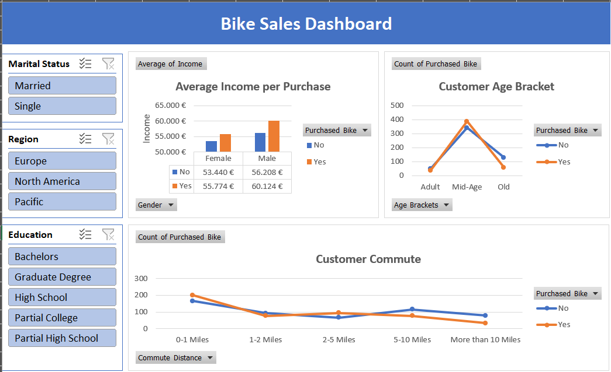

# Bike Sales Dashboard (Excel)

An interactive Excel dashboard that explores which customer groups buy bikes, built with data cleaning, PivotTables, PivotCharts and slicers.

## Business Problem

A bike retailer wants to know **who buys its bikes** so it can target marketing and sales efforts better. This dashboard answers questions such as:

- Which customer segments (age, gender, marital status, education, region) are most likely to buy a bike?
- Does income differ between customers who bought a bike and those who did not?
- Does commute distance relate to buying a bike?
- Which age groups should campaigns focus on?

## Dataset

Customer-level data with one row per customer.

| Column | Description |
|---|---|
| ID | Unique customer ID |
| Marital Status | Married / Single |
| Gender | Female / Male |
| Income | Annual income |
| Children | Number of children |
| Education | Highest education level |
| Occupation | Job category |
| Home Owner | Yes / No |
| Cars | Number of cars owned |
| Commute Distance | Distance bands (0-1, 1-2, 2-5, 5-10, 10+ miles) |
| Region | Europe / North America / Pacific |
| Age | Customer age |
| **Age Brackets** | *Added by me:* Adult / Mid-Age / Old |
| Purchased Bike | Yes / No (target variable) |

## Process

1. **Data cleaning**
   - Removed duplicate records (by ID)
   - Checked every column for blanks and inconsistent labels
   - Converted the data into an Excel Table so PivotTables resize on refresh
2. **Feature engineering**
   - Created an `Age Brackets` column from `Age` (Adult, Mid-Age, Old)
3. **Analysis with PivotTables**
   - Average income by gender and purchase status
   - Number of purchases by age bracket
   - Number of purchases by commute distance
   - Purchase rate (% of customers who bought) per age bracket and commute distance, using *Show Values As → % of Row Total*
4. **Dashboard**
   - PivotCharts linked to the PivotTables
   - Slicers for Marital Status, Region and Education to filter all charts at once

## Dashboard Contents

| Chart | Question it answers |
|---|---|
| Average Income per Purchase | Do buyers earn more or less than non-buyers, by gender? |
| Customer Age Bracket | Which age groups buy bikes most often? |
| Customer Commute | How does commute distance relate to buying a bike? |

## Key Insights

All figures are for the full dataset (no slicer filters applied).

- **Income:** Customers who bought a bike have a higher average income than those who did not, for both genders (women: 55,774 € vs 53,440 €; men: 60,124 € vs 56,208 €). The difference is modest, so income alone is not a strong predictor.
- **Age:** Mid-Age customers are the largest segment and buy slightly more often than they abstain (~390 buyers vs ~345 non-buyers). Older customers are much less likely to buy (~60 buyers vs ~130 non-buyers).
- **Commute distance:** Customers living within 1 mile of work are the most likely to buy (~200 buyers vs ~165 non-buyers). Beyond 5 miles, non-buyers outnumber buyers.
- **Purchase rate by age:** 53.2% of Mid-Age customers bought a bike, compared with 42.2% of Adults and 31.2% of Old customers. Mid-Age customers are the most likely to buy, and the purchase rate drops sharply for older customers.
<!-- TODO: add purchase rate by commute distance once calculated -->

Note: these are associations in the data, not proof of cause and effect.

## Recommendations

- Focus campaigns on Mid-Age customers, the largest group with a slight tilt towards buying.
- Target customers with short commutes (0-1 miles), who are the most likely buyers.
- Review the offer for older customers and long-distance commuters, where purchase rates are lowest (for example, models better suited to them).
- Consider income in targeting, but as a secondary factor given the small gap.

## Tools

- Microsoft Excel: PivotTables, PivotCharts, Slicers, Tables, data cleaning

## Challenges and Learnings

- Removing duplicates after building the PivotTables left stale "(blank)" items in the slicers. Fixed by refreshing the PivotTables and enabling *Hide items with no data* in the slicer settings.
- Lesson learned: clean the raw data first, and base PivotTables on an Excel Table.

## Limitations

- The data shows correlations, not causes.
- Small sample size; results may not generalize.
- Age brackets are my own definition, and other cut-offs could change the picture.

## Files

- `Bike_Sales_Dashboard.xlsx`: cleaned data, PivotTables and dashboard
- `images/dashboard.png`: dashboard screenshot

## Credits

Dataset and dashboard idea based on a YouTube tutorial:
